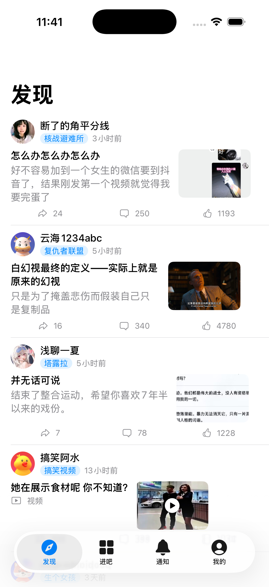

# TiebaLite iOS（ios 分支）

百度贴吧第三方客户端 TiebaLite 的 **iOS 原生实现**（SwiftUI）。与 `main` 分支的
Android 版共用同一套贴吧协议（protobuf 端点、签名算法、设备指纹），协议层 1:1 移植。



## 功能状态（v1）

| 功能 | 状态 | 通道 |
|---|---|---|
| 发现页·个性化推荐 | ✅ 真实数据 | protobuf `/c/f/excellent/personalized` |
| 吧页（最新/精华） | ✅ 真实数据 | protobuf `/c/f/frs/page` |
| 帖子内容·富文本 | ✅ 真实数据 | protobuf `/c/f/pb/page` |
| 用户主页 | ✅ 接口就绪 | protobuf `/c/u/user/profile` |
| 登录（BDUSS） | ✅ | WKWebView wappass → `/c/s/login` |
| 楼中楼详情/搜索/通知/点赞/签到 | ⏳ 后续迭代 | — |

## 构建

要求：macOS + Xcode（本工程在 Xcode 26.6 验证）+ Python 3（生成 pbxproj）。

```bash
cd ios

# 0) 一次性工具链（可选，仅重新生成 proto 时需要：protoc + protoc-gen-swift 1.28.2）
./scripts/bootstrap_tools.sh

# 1) 生成 Xcode 工程（源文件增删后重跑；proto 变更后先跑 generate_protos.sh）
python3 scripts/gen_project.py

# 2) 构建 adhoc 签名的 ipa（产物 ios/build/TiebaLite-adhoc.ipa）
./scripts/build_ipa.sh
```

产物验收：`codesign -dv` 显示 `Signature=adhoc`、`TeamIdentifier=not set`，
包内无 `embedded.mobileprovision`。**adhoc 包不能直接安装到非越狱设备**——
用你自己的证书/描述文件重签后安装（如 `codesign -f -s "iPhone Distribution: ..."` 或
AltStore/Sideloadly 等工具重签）。

## 工程结构

```
ios/
  TiebaLite.xcodeproj/        # scripts/gen_project.py 生成（勿手改）
  App/Sources/
    Core/Device/              # helios 设备指纹（1:1 移植，JDK 真实向量测试 7/7）
    Core/API/                 # 签名/multipart 信封/CommonRequest/端点/登录
    Features/                 # 发现/吧页/帖子/登录/我的
  Generated/Protos/           # protoc 生成物（勿手改；与 Android 端 proto 同源）
  ThirdParty/SwiftProtobufRuntime/  # swift-protobuf 1.28.2 源码（静态库 target）
  Tests/                      # helios 向量对照 + 真实 API 冒烟测试
  scripts/                    # 工具链下载/proto 生成/工程生成/ipa 构建
  docs/                       # 计划书（IOS_PLAN.md）与阶段记录（PROGRESS.md）
```

## 协议要点（已亲核 Android 端源码）

- **签名**：`sign = MD5(参数名排序 name=value 无分隔符拼接 + "tiebaclient!!!")`；
  V12 系列 protobuf 请求的信封不含 `_client_version` part，因此**不签名**
- **multipart 信封**：boundary 固定 `--------7da3d81520810*`；part 顺序 `stoken?` → `data`
- **设备指纹**：`helios` 40-bit BitSet 哈希链（CRC32+xxHash32×2+CRC32，注意初始全 1、
  前 len 字节截断、逻辑右移三个坑），iOS 侧 androidId 用持久化随机 16hex 替代
- **登录**：wappass WebView 登录 → 抓 `BDUSS/STOKEN` → `/c/s/login` 换 uid/tbs

## 测试

```bash
xcodebuild -project TiebaLite.xcodeproj -scheme TiebaLite \
  -destination 'platform=iOS Simulator,name=iPhone 17 Pro' test
```

- `HeliosHasherTests`：7 个向量与 Temurin 17 运行 Android 同源 Java 的输出逐字节一致
- `NetworkSmokeTests`：真实调用贴吧接口（需外网），断言返回非空数据

## 许可

与上游 TiebaApp 相同（见仓库根 LICENSE）。仅供学习研究，勿用于生产环境；
API 协议归属百度所有。
